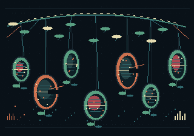

# Hanging Orchard — Fruit of Incorrect Addresses

**ART-EVOL-004 / executable source-and-search candidate.** This is a new, independent deterministic evolutionary session under `gallery/evolution/`. It is **not** a completed or visually accepted native quarry. The Windows renderer cannot execute in the author environment, so no mined specimen, final PNG, completion metrics or false aesthetic verdict is claimed.



*Actual byte-exact PNG rendition of the committed original BMP, inspected visually; it is an **unfaulted source preview**, not a selected canonical specimen or a simulated FAULTMINE render.*

## Artistic problem

An austere botanical suspension: seven differing fruit capsules hang from one irregular wire-canopy above a deliberately vacant lower register. Their pale internal cross-sections are crossed by quiet ferric horizontals, and several fruit membranes are cut open. The source is explicitly graphic rather than photographic; it is original vector/primitive drawing rasterised deterministically into a 320×224 RGB24 BMP, no outside imagery, borrowed fonts or remote dependencies. Unlike the prior archaeological apertures (#39), shoreline (#41), and indexed pseudo-glyph tablets (#45), the identifiable form to preserve is a **fragile branching canopy with isolated hanging organic volumes**.

The quarry searches for candidate faults that dislocate a portion of the fruit membranes or their stem attachments while retaining enough branching structure that the result still reads as suspended growth. A uniform noise cloud, negligible colour flip or loss of all negative space is a rejection, even if FM-014 selects it for mathematical novelty. Inspect full-size actual native outputs, not just descriptor scores or proxies.

## Immutable source and exact address

- Base main at authorship: `8d706fbd58fa6db2fc10cd3b9208917273674705`.
- Parent: accepted `examples/fm003-starter-genome.json`, Git blob `40e2d690078c62d6c80c40a550165672a2a1f997`, retained unchanged; inherited root seed `0123456789abcdef`.
- Original self-contained `source.bmp` (320×224 RGB24), generated by `make-source.mjs`; source Git blob `7186d6dc03dc60032ca64e891ad4a6d5e50786db`; source file SHA-256 `6fdf39e9d9f6b211d6b9ef69aa1eb725f9a53e058ab2621e68550dbd3943b4c5`; normalized straight RGBA8 WIC-expected source identity `861f3393c8c0029a7d68d03ad8b495b5d3a678e877bb995b9defc08e8ccf5046` (independently decoded from committed BMP bytes). `node make-source.mjs --verify` checks every committed BMP byte; `--write` refuses overwrite.
- FM-009 mutation seed `8a7c1940e6db2f53`, indexed descendants `[0,144)`, `high` typed radius, explicit frame 0, canonical **full-resolution CPU rendering** (never proxy), 4 threads, descriptor-v1 L1 near threshold **10000 inclusive**, 12 diversity selections, FM-012 full-resolution selected stills/contact sheet, verified alternate-thread resume.
- No old gallery art or sibling worker branch is read or modified at runtime. The output folder is new and must not exist before invoking the script.

## Real Windows qualification

With Windows x64 MSVC Debug/Release configured and built (see root README):

```powershell
.\\gallery\\evolution\\04-hanging-orchard\\mine.ps1 -OutputDirectory .\\evidence\\orchard-04 -Threads 4
```

The script validates original Git blobs; executes real `FAULTMINE-batch.exe` with a bounded 144-candidate full-resolution canonical search; fails on incomplete/partial results; audits index order, exact/near diversity and FM-012 still/sidecar presence; re-runs with one-thread `--resume` and requires the semantic manifest to remain byte-identical; and checks every mathematically selected native still using **both** Debug and Release `FAULTMINE-render.exe --verify` without rewriting PNGs. A failed run retains evidence and cannot overwrite that folder. It writes a factual `audit.json` only if all gates pass.

## Required curation before admission

1. Read the true `batch.fmbatch.json` counters and `audit.json`, and examine the genuine `selected-contact-sheet.png` and full-size selected native PNGs. The contact sheet is a presentation artifact, not a canonical specimen.
2. Reject exact/near duplicates, colour-only drift and unstructured destruction. Choose a single clearly differentiated work, explaining its relation to the suspended canopy and naming at least two rejected alternatives.
3. Preserve the selected exact child genome, full-resolution canonical PNG and native FM-012 sidecar, source/parent/seed/index/frame, candidate identity, decoded output identity, and preview contact sheet. Add a verified replay/identity checker and keep original inputs immutable.
4. Integration performs native GUI opening and source relink; owner performs aesthetic admission. Stay Draft until then. No other project or artwork paths should change.

**Evidence status at submission:** authored deterministic source, visually inspected unfaulted source preview, immutable parent and executable search driver only. Candidate count is a **request** of 144, not a claimed count of completed specimens. No actual post-fault image or selected artwork has been inspected.
