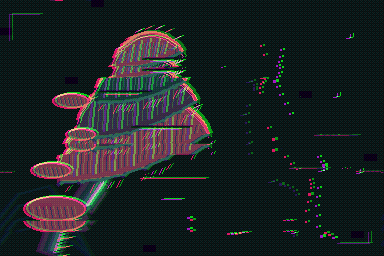

# SPORE LEDGER / 03 — The Disobedient Canopy

**Status: Windows CPU canonical PNG archived, decoded-pixel identity and Debug/Release native replay passed. Draft; physical GUI and artistic admission remain pending.**

An asymmetrical, tiered fungal canopy occupies the left of an intentionally dark field. The right third contains three discontinuous spore trajectories. Each shelf carries fine gill registrations and ochre cuts. Its biological silhouette and open negative space distinguish it from MOTH ROM's bilateral electronics, Witness Relay's train carriage, the temporal signal aperture and the evolutionary glyph quarries. The 384×256 source was authored with local integer-coordinate polygons, raster strokes and palette work. No photographs, borrowed textures, remote assets or external fonts were used.

## Fault composition

The intended stack is **intermittent 11-row memory repeat**, seven bounded logical address bursts, red-blue channel displacement, localized green bit perforations, 24-level RGB quantization and Bayer4 ordered dithering. The creative objective is controlled slippage of the canopy's gill structure while retaining the larger living silhouette, not generic noisy recoloring. The native canonical result was independently decoded and visually inspected after Windows rendering. The fungal shelves and separated spore trajectories remain legible, while coloured misregistration fractures their fine registrations. This assessment describes the observed pixels; artistic acceptance remains independent.

## Pinned replay identity

- Source image: opaque, 4-bit indexed PNG, 384×256. Encoded SHA-256 `229cf7c953ce5650aec86df9a606b8fa338d4b210085c0d6d938ff6b932f5021`.
- Normalized source RGBA8 identity `8afaccd3d00d080b330397f9ab78674832e67ec52c7e65464542d5214d181bc5`.
- Genome schema v1, engine contract v1, canonical LF genome SHA-256 `bd645afc85a5f8200a03b273ae2e6c1b5f975384cbe5152ebd9d8620eb206fec`.
- Root seed `c6e15af039bd2471`, explicit frame **0**.
- Project schema v2, one manual-root favourite, no mutation/crossover history.
- Source is the committed original image; it is **not** an output of FAULTMINE's fault pipeline.

## Canonical Windows qualification and archived result

From the repository root, after `scripts/configure.ps1` and native Debug/Release builds:

```powershell
python gallery/originals/03-spore-ledger/verify_artwork.py
.\gallery\originals\03-spore-ledger\render-win.ps1 -OutputDirectory .\artifacts\spore-ledger-native -CrossCheckDebug
```

`render-win.ps1` refuses overwrite, checks original/genome identities, invokes the supported Windows `FAULTMINE-render.exe --frame 0`, verifies decoded canonical RGBA pixels in Release and Debug, and records native identities after successful replay. This driver was executed by Integration in [Windows qualification run #42955357432](https://github.com/techrote/FAULTMINE/actions/runs/42955357432) at exact author head `6591689276d4e1ee1174094596a2d255fe0e849f` against engine main `52f1496015d8638ab0221d7c7b1f2c1d086d8979`.

### Archived evidence (immutable source/genome/project preserved)



- Actual Windows native CPU canonical PNG: [`canonical-evidence/spore-ledger-canonical.png`](canonical-evidence/spore-ledger-canonical.png), 384×256 RGBA8, frame 0.
- Native renderer audit: [`canonical-evidence/native-replay-receipt.json`](canonical-evidence/native-replay-receipt.json), explicitly *not* an FM-012 manifest.
- Source identity: `8afaccd3d00d080b330397f9ab78674832e67ec52c7e65464542d5214d181bc5`.
- Canonical genome identity: `bd645afc85a5f8200a03b273ae2e6c1b5f975384cbe5152ebd9d8620eb206fec`; seed `c6e15af039bd2471`.
- Decoded output identity: `8cf910493a00d66eb57970e23d3fc374fa9f581707546038692de2699eb0ed23`.
- Encoded PNG SHA-256: `a6fec5a377f00c2b0517f1f1c9411c94817a6abc11500fafee14563798f08959`.
- Windows Debug/Release read-only pixel replay passed; native post-fault output was visually examined as a fungal canopy retaining a tiered contour with visible shifted gills and interrupted spores. Compared with Witness Relay's architectural silhouette, this is an organic asymmetric composition.
- Run `python gallery/originals/03-spore-ledger/verify_artwork.py` from any Python 3 environment for strict input/project checks and independent archived RGBA8 PNG/receipt checking (includes negative corruption/forgery cases).
- For genuine Windows source-engine replay, run `build\Release\FAULTMINE-render.exe --verify --frame 0 gallery\originals\03-spore-ledger\source.png gallery\originals\03-spore-ledger\genome.json gallery\originals\03-spore-ledger\canonical-evidence\spore-ledger-canonical.png`, and independently repeat under `build\Debug\FAULTMINE-render.exe`. Use read-only verification; do not recalculate or rewrite the archived output.

**Outstanding gates:** actual Win32 GUI project load/source relink, FM-012 GUI export, owner aesthetic acceptance. The source and original genome/project remain unchanged. PR stays Draft; Integration decides admission, no self-merge.
